# Lược đồ cho báo cáo

Danh sách chức năng: xem `phan-tich-chuc-nang.md`. Ghi chú trong lược đồ viết bằng tiếng Anh.
Xem/xuất ảnh: dán từng khối mã vào https://mermaid.live (Actions → PNG/SVG).

- Chức năng 1–5: vẽ theo **code hiện tại**.
- Chức năng 6 (Shop): vẽ theo `thiet-ke-shop.md`, **chưa có code**. Tên class đánh dấu *(planned)*, cần đối chiếu lại khi cài đặt.

---

## 1. Điều khiển nhân vật và sinh tồn

### 1.1. Sơ đồ trạng thái: Player

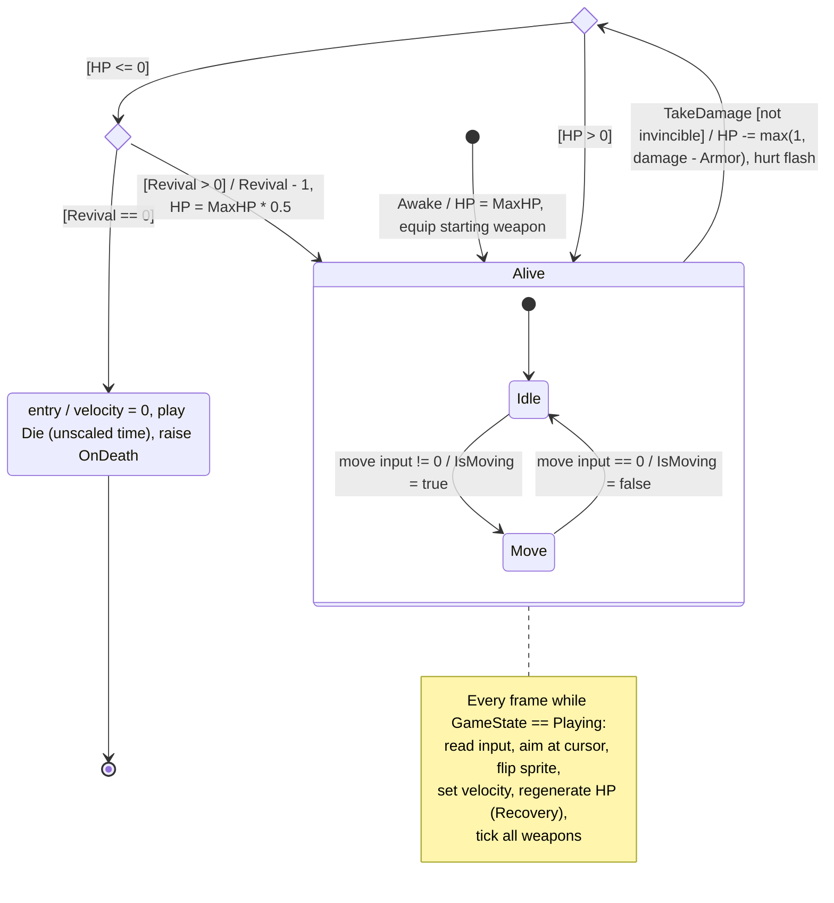

### 1.2. Sơ đồ tuần tự: Player nhận sát thương từ quái

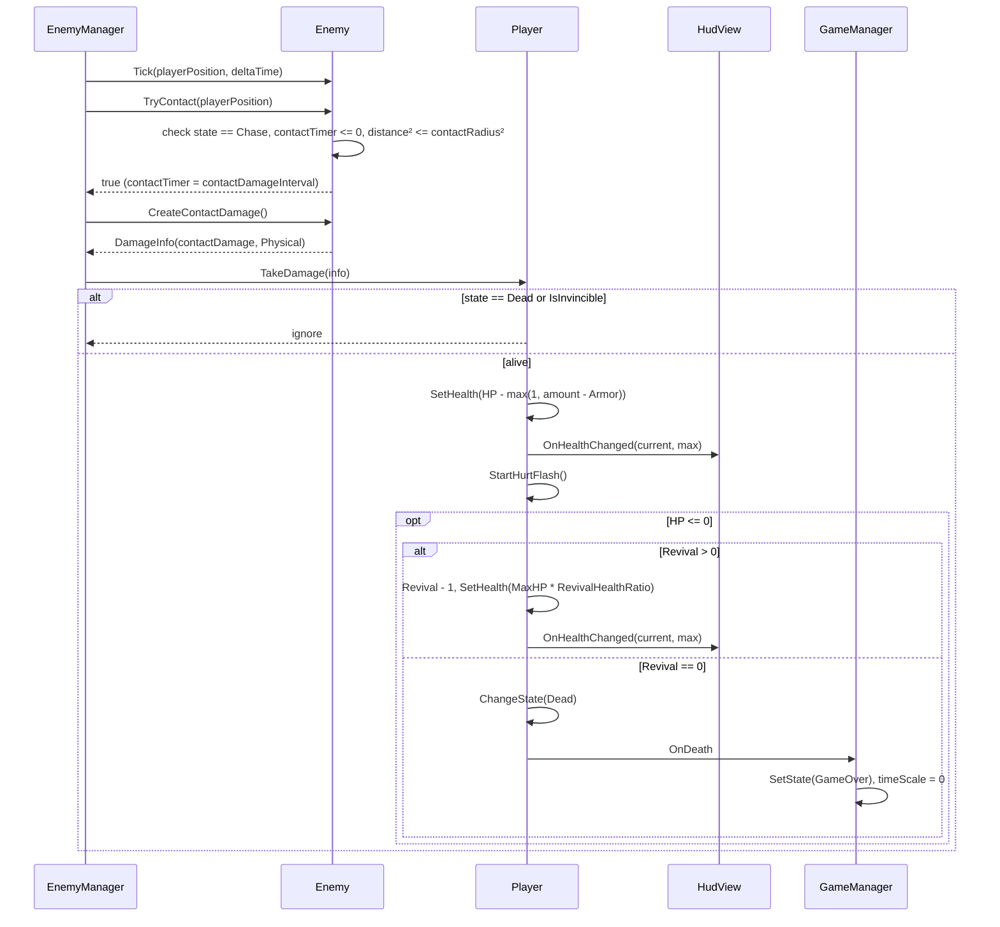

---

## 2. Tấn công tự động

### 2.1. Sơ đồ trạng thái: Weapon

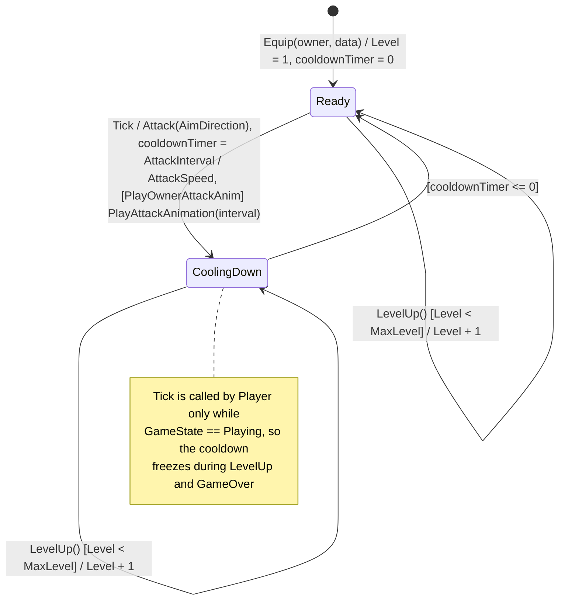

### 2.2. Sơ đồ tuần tự: một lần chém (SwordSlash)

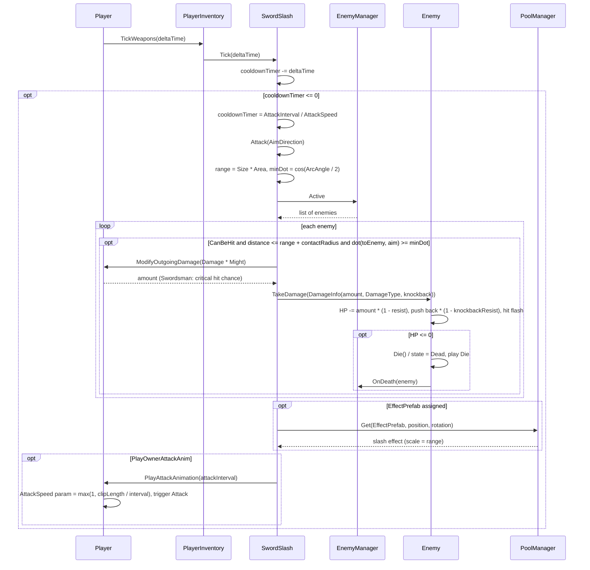

---

## 3. Quái xuất hiện, truy đuổi và tấn công

### 3.1. Sơ đồ trạng thái: Enemy (gồm vòng đời trong pool)

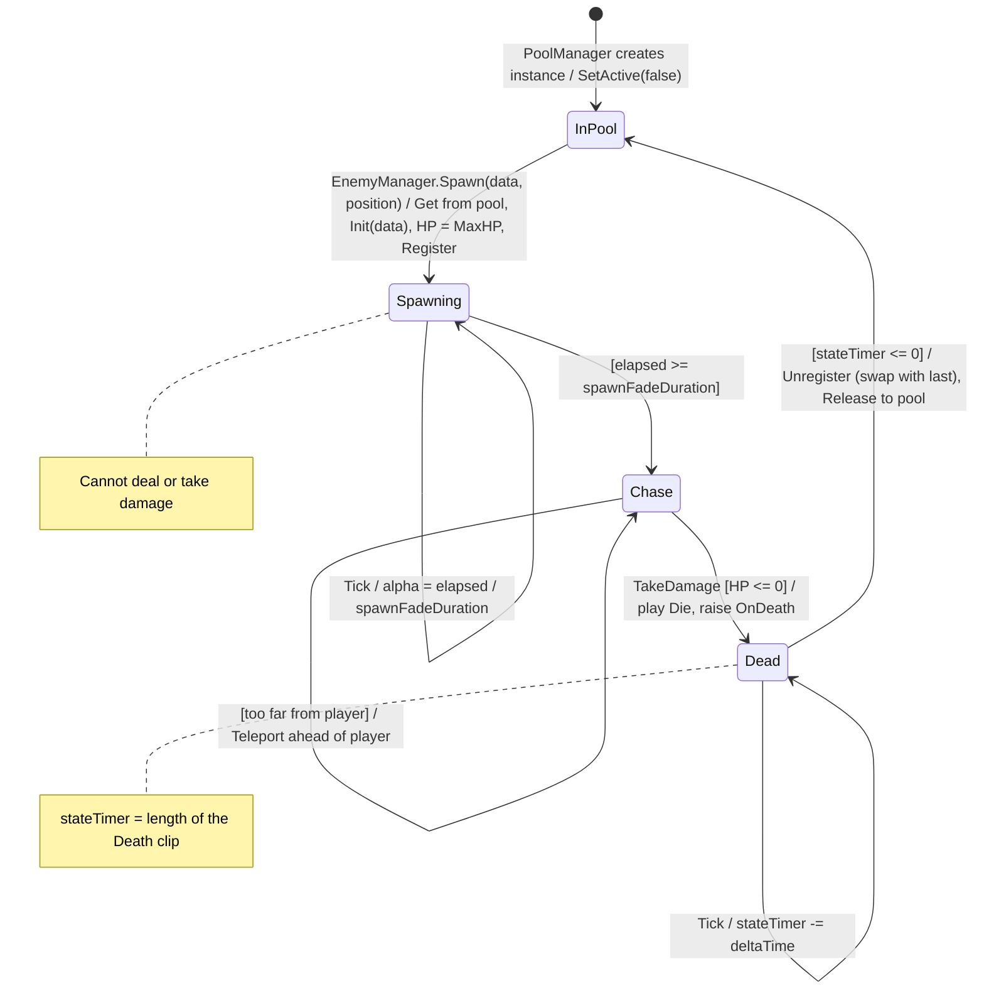

### 3.2. Sơ đồ tuần tự: spawn, cập nhật mỗi frame và thu hồi quái

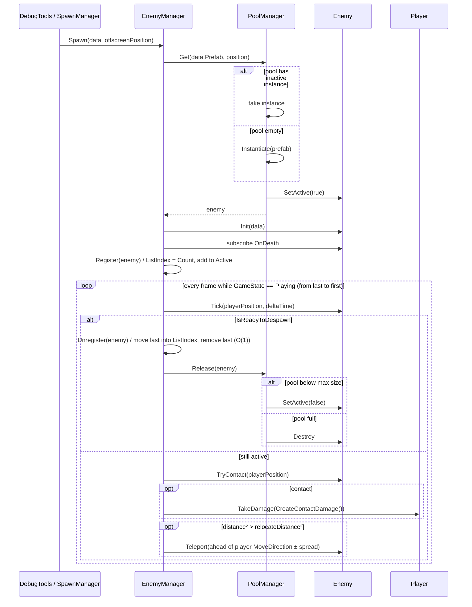

---

## 4. Thu thập kinh nghiệm và vàng

### 4.1. Sơ đồ trạng thái: Pickup (gem / coin)

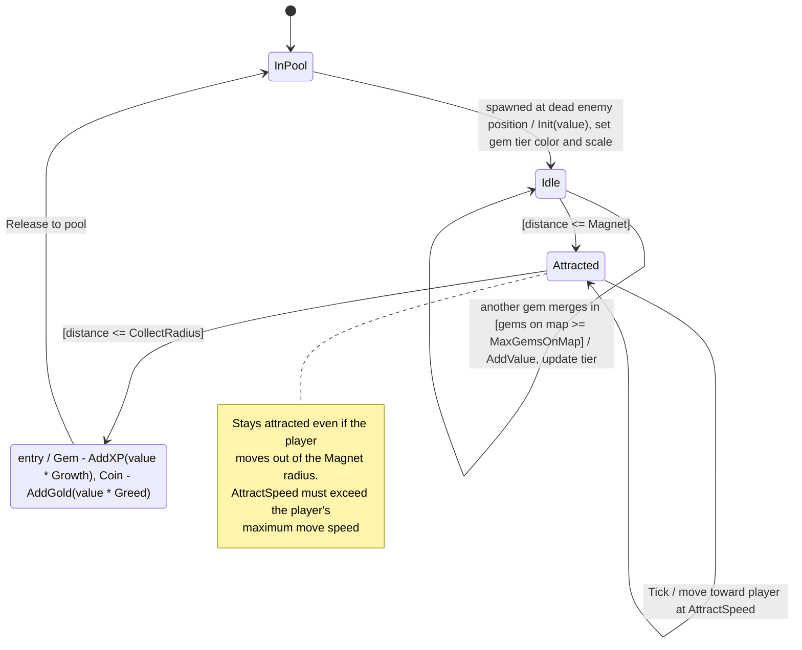

### 4.2. Sơ đồ tuần tự: quái chết rơi đồ và người chơi nhặt

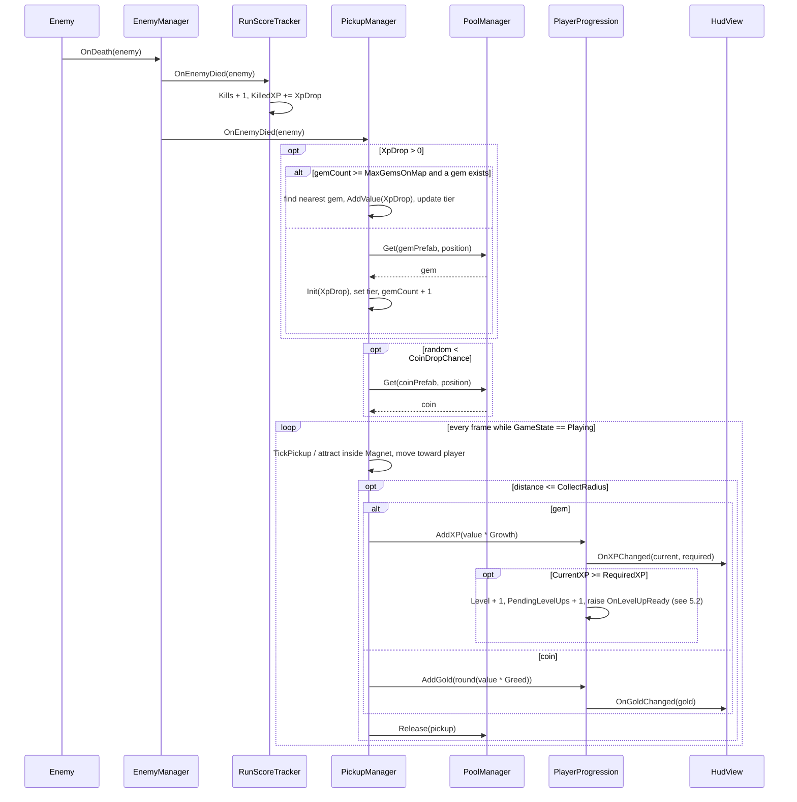

---

## 5. Lên cấp và chọn nâng cấp

### 5.1. Sơ đồ trạng thái: GameManager

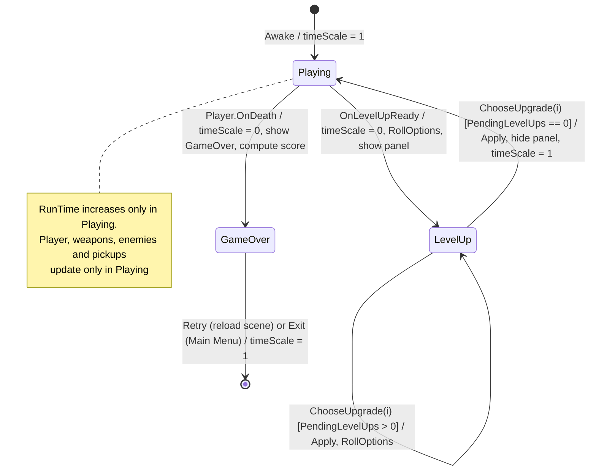

### 5.2. Sơ đồ tuần tự: lên cấp và chọn thẻ

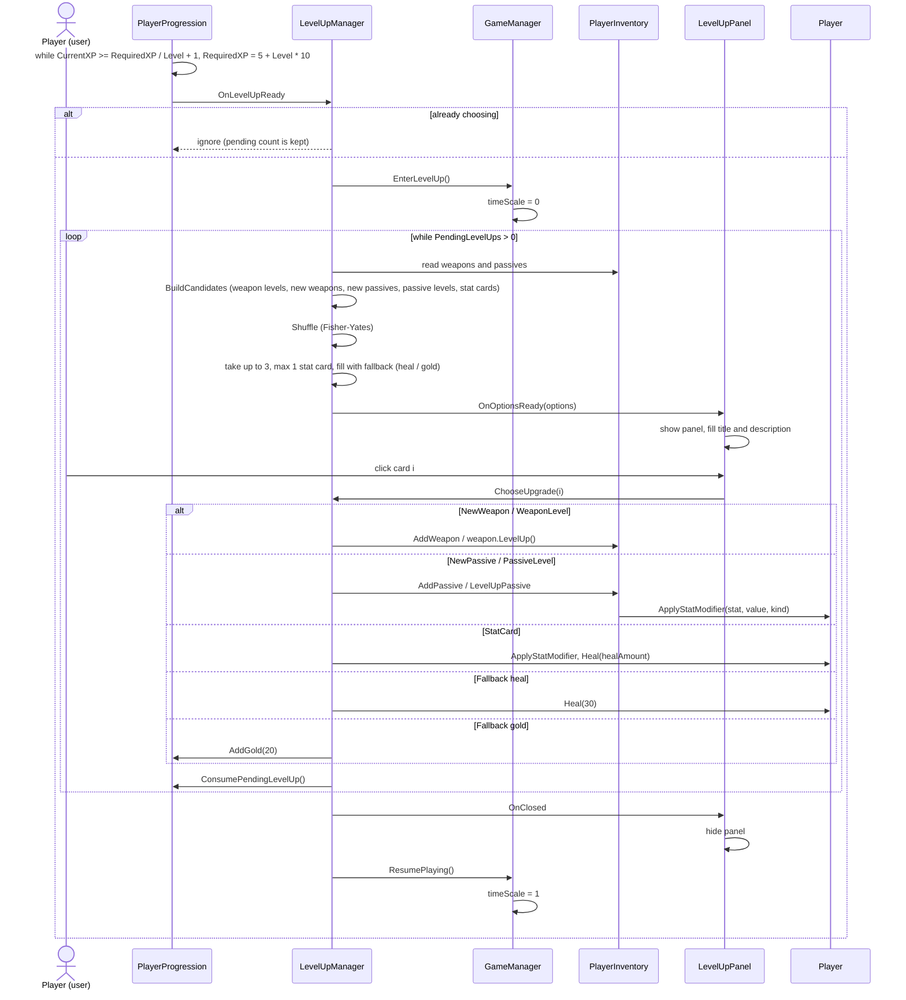

---

## 6. Shop trong ván *(planned)*

### 6.1. Sơ đồ trạng thái: Shop

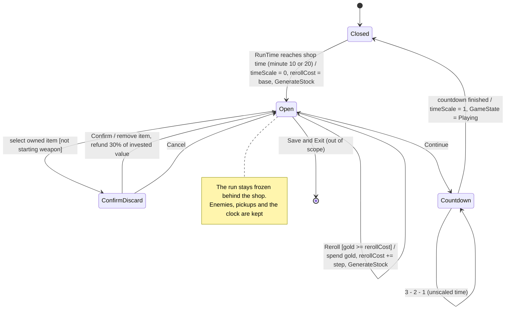

### 6.2. Sơ đồ tuần tự: mở Shop, bày hàng và mua một món

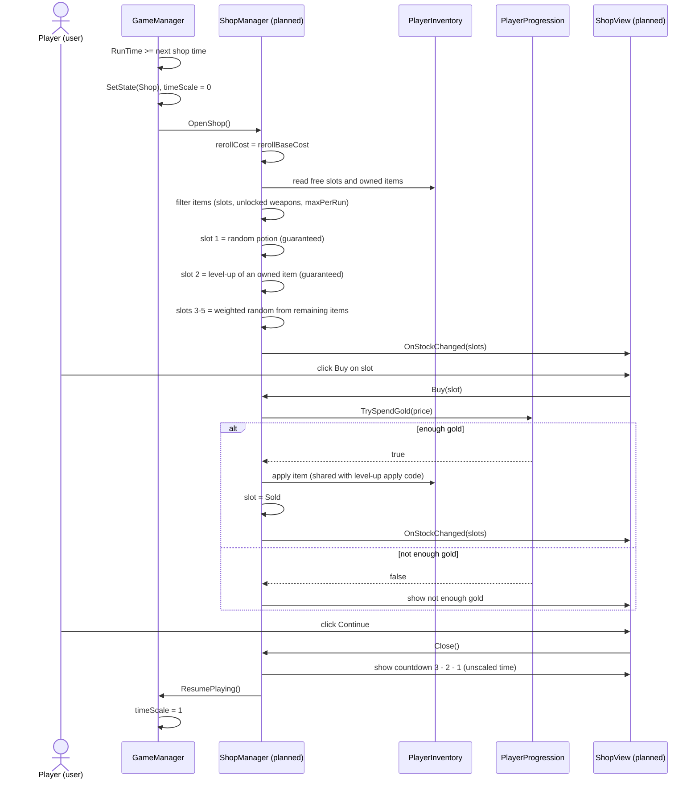
