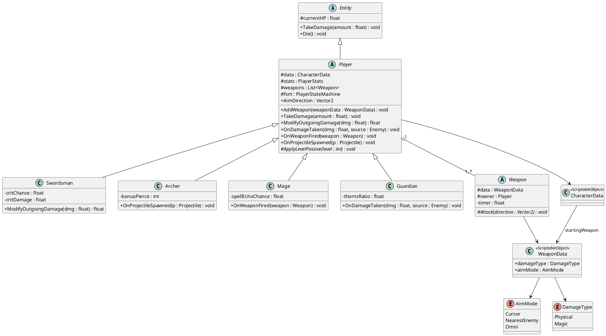
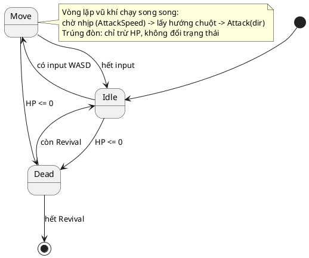

# Thiết kế nhân vật chính

Game: Survival Action kiểu Vampire Survivors (Unity), góc nhìn 2,5D (map 2D, di chuyển tự do 8 hướng)
Phụ trách: Nhóm trưởng (Core: data và kịch bản)
Trạng thái: **Đã chốt v2**, trừ các mục ở phần 11.

Quy ước: **mọi tên class, hàm, biến trong code viết bằng tiếng Anh**. Tên hiển thị trong game có thể là tiếng Việt.

---

## 1. Tổng quan 4 lớp nhân vật

Cả 4 lớp **mở sẵn từ đầu**, không cần mở khóa.

| Lớp (hiển thị) | Class trong code | Vai trò | Lối chơi | Độ khó chơi |
|---|---|---|---|---|
| Kiếm sĩ | `Swordsman` | Cận chiến, cân bằng | Áp sát, chém dọn quái xung quanh | ★☆☆ |
| Cung thủ | `Archer` | Tầm xa, cơ động | Chạy vòng, bắn từ xa | ★★☆ |
| Pháp sư | `Mage` | Sát thương diện rộng | Mạnh nhưng mỏng, cần giữ khoảng cách | ★★★ |
| Đỡ đòn | `Guardian` | Chống chịu | Trâu, chậm, sát thương thấp | ★☆☆ |

Mọi nhân vật dùng **chung một bộ chỉ số**, khai báo ở lớp cha `Player`. Mỗi lớp khác nhau ở bốn điểm: vũ khí khởi đầu, điều chỉnh chỉ số so với nền, một **chỉ số đặc trưng khai báo ở lớp con**, và một nội tại mạnh dần theo cấp.

---

## 2. Bộ chỉ số chung

| # | Chỉ số | Mã | Giá trị nền | Ý nghĩa | Mức |
|---|---|---|---|---|---|
| 1 | Máu tối đa | `MaxHP` | 100 | Lượng máu tối đa | Cốt lõi |
| 2 | Hồi máu | `Recovery` | 0 HP/giây | Tự hồi máu theo thời gian | Cốt lõi |
| 3 | Giáp | `Armor` | 0 | Mỗi điểm giảm **8%** sát thương nhận vào, tối đa **60%** | Cốt lõi |
| 4 | Tốc độ di chuyển | `MoveSpeed` | 100% (5 đơn vị/giây) | Tốc độ chạy | Cốt lõi |
| 5 | Sức mạnh | `Might` | 100% | Nhân sát thương mọi vũ khí | Cốt lõi |
| 6 | Tốc độ đánh | `AttackSpeed` | 100% | Càng cao thì thời gian chờ giữa hai đòn càng ngắn | Cốt lõi |
| 7 | Vùng ảnh hưởng | `Area` | 100% | Kích thước đòn đánh, vụ nổ, hào quang | Cốt lõi |
| 8 | Số đạn mỗi lượt | `Multishot` | +0 | Số viên thêm mỗi lượt tấn công (game không giới hạn đạn) | Cốt lõi |
| 9 | Bán kính hút | `Magnet` | 1,5 đơn vị | Khoảng cách tự hút gem và coin | Cốt lõi |
| 10 | Tốc độ đạn | `ProjectileSpeed` | 100% | Tốc độ bay của đạn | Mở rộng |
| 11 | Thời gian hiệu lực | `Duration` | 100% | Thời gian tồn tại của hiệu ứng | Mở rộng |
| 12 | Kinh nghiệm | `Growth` | 100% | Nhân lượng XP nhặt được | Mở rộng |
| 13 | Vàng | `Greed` | 100% | Nhân lượng vàng nhặt được | Mở rộng |
| 14 | Hồi sinh | `Revival` | 0 | Số lần sống lại với 50% máu | Mở rộng |

Game **không có chỉ số May mắn**: tỉ lệ rơi đồ và tỉ lệ ra nâng cấp hiếm là cố định, ghi trong dữ liệu của từng loại quái và từng nâng cấp.

Cả 15 chỉ số được **khai báo đầy đủ** trong `PlayerStats` ngay từ đầu. Logic được cài trước cho 9 chỉ số cốt lõi; 6 chỉ số còn lại chỉ cài khi cần.

### Loại sát thương

Mỗi nguồn gây sát thương (vũ khí, phản đòn) mang một loại sát thương, ghi trong dữ liệu của **nguồn đó**, không ghi theo nhân vật. Vì vậy một Pháp sư nhặt kiếm vẫn gây sát thương vật lý bằng kiếm.

| Loại | Mã | Bị giảm bởi (ở quái) |
|---|---|---|
| Vật lý | `Physical` | `Armor` của quái |
| Phép | `Magic` | `MagicResist` của quái |

Kháng của quái tính theo **phần trăm**, không trừ thẳng. Lý do: nhiều nguồn sát thương trong game có mỗi đòn rất nhỏ (hào quang 5 sát thương mỗi nhịp, mưa tên 8 mỗi đợt). Nếu kháng trừ thẳng, một con quái có 5 giáp sẽ miễn nhiễm hoàn toàn với những nguồn này.

### Công thức

```
Sát thương gây ra    = BaseDamage × Might × (chí mạng ? CritDamage : 1)
Sát thương lên quái  = Sát thương gây ra × (1 − Kháng%)     Kháng% = Armor% nếu Physical, MagicResist% nếu Magic
Sát thương nhận      = max(1, EnemyDamage × (1 − min(Armor × 8%, 60%)))   (Armor của Player giảm theo %, áp dụng cho mọi đòn)
Tốc độ di chuyển     = 5 × MoveSpeed                       (đơn vị/giây)
Thời gian giữa 2 đòn = WeaponBaseAttackInterval / AttackSpeed
Số viên mỗi lượt     = WeaponBaseProjectiles + Multishot
Kích thước đòn       = WeaponBaseSize × Area
```

---

## 3. Chỉ số riêng từng lớp

### 3.1. Bảng so sánh (ô trống = giữ giá trị nền)

| Chỉ số | Swordsman | Archer | Mage | Guardian |
|---|---|---|---|---|
| MaxHP | **120** | 80 | 70 | **150** |
| Recovery | | | | **+0,2/giây** |
| Armor | +1 | 0 | 0 | **+2** |
| MoveSpeed | 100% | **115%** | 95% | 90% |
| Might | **110%** | 100% | 100% | 90% |
| AttackSpeed | | 105% | **110%** | |
| Area | 110% | | **115%** | |
| ProjectileSpeed | | **120%** | | |
| Duration | | | 110% | |

### 3.2. Chi tiết

| | Swordsman | Archer | Mage | Guardian |
|---|---|---|---|---|
| **Vũ khí khởi đầu** | Kiếm chém (`SwordSlash`) | Cung gỗ (`WoodenBow`) | Tia phép (`ArcaneBolt`) | Trọng kích (`HeavyStrike`) |
| **Sát thương / nhịp gốc** | 10 / 1,2 giây | 8 / 1,0 giây | 10 / 1,0 giây | 12 / 1,6 giây |
| **Loại sát thương** | Vật lý | Vật lý | **Phép** | Vật lý |
| **Cách đánh** | Chém vòng cung 120°, tầm 2 đơn vị, theo hướng chuột | Bắn tên theo hướng chuột, xòe quạt nếu `Multishot` > 0 | Tia phép bay nhanh theo hướng chuột, **chạm quái thì nổ thành vùng tròn nhỏ** (bán kính 0,8) gây sát thương mọi quái trong vùng. Lên cấp tăng bán kính nổ và số quái xuyên qua | Đánh cận chiến vòng cung 90°, tầm 1,5 đơn vị, theo hướng chuột, **đẩy lùi mạnh** |
| **Chỉ số đặc trưng (lớp con)** | `critChance` 10%, `critDamage` ×1,5 | `bonusPierce` +1 | `spellEchoChance` 10% (thi triển lại ngay) | `thornsRatio` **5%** (phản sát thương vật lý, **tối đa 10 mỗi đòn** để boss không tự giết mình) |
| **Nội tại** | *Chiến ý*: mỗi 10 cấp +5% Might (tối đa +25%) | *Mắt ưng*: mỗi 20 cấp +1 Multishot (tối đa +2) | *Tinh thông*: mỗi 10 cấp +2% AttackSpeed (tối đa +10%) | *Thành trì*: mỗi 10 cấp +10 MaxHP (không giới hạn) |
| **Điểm yếu** | Tầm ngắn, khó đối phó quái bắn xa | Máu thấp, không giáp | Máu thấp nhất, chậm, đầu trận yếu | Sát thương thấp, dọn quái lâu |

### 3.3. Tổng quan độ mạnh

| | Swordsman | Archer | Mage | Guardian |
|---|---|---|---|---|
| Sống sót | ●●●○ | ●●○○ | ●○○○ | ●●●● |
| Sát thương | ●●●○ | ●●●○ | ●●●● | ●○○○ |
| Dọn quái đông | ●●○○ | ●●○○ | ●●●● | ●●●○ |
| Cơ động | ●●○○ | ●●●● | ●○○○ | ●○○○ |

---

## 4. Điều khiển và hướng ngắm

| Hành động | Phím |
|---|---|
| Di chuyển 8 hướng | WASD |
| Ngắm | Chuột |
| Tấn công | **Tự động** theo `AttackSpeed`, về hướng chuột |

- Mỗi khung hình, `Player` tính `AimDirection = (vị trí chuột trong thế giới − vị trí Player).normalized`. Mọi vũ khí dùng chung giá trị này.
- **Sprite quay theo hướng chuột**, không theo hướng chạy: `flipX = AimDirection.x < 0`.
- Khi chạy ngược hướng nhìn, animation Walk vẫn phát bình thường.
- `WeaponData.aimMode` gồm `Cursor` (theo chuột), `NearestEnemy` (tự tìm quái gần nhất), `Omni` (tỏa mọi hướng). Nhờ đó các vũ khí nhận thêm sau này (vòng xoay, hào quang, …) vẫn dùng chung hệ thống.

---

## 5. Kiến trúc lớp

```
Entity (HP, TakeDamage, Die)
 └── Player (abstract): input, FSM, 14 chỉ số chung, danh sách Weapon, nhận sát thương, hook
      ├── Swordsman   (critChance, critDamage)
      ├── Archer      (bonusPierce)
      ├── Mage        (spellEchoChance)
      └── Guardian    (thornsRatio)

Player ──có nhiều──> Weapon (mỗi loại vũ khí là một lớp con)
Player ──đọc──> CharacterData (ScriptableObject)
```

Nguyên tắc:
- **Cách đánh nằm trong `Weapon`, không nằm trong lớp con của `Player`.** Người chơi còn nhận thêm vũ khí khi lên cấp và khi mua ở Shop. Một Pháp sư mua kiếm vẫn phải chém được.
- **Chỉ số chung nằm ở lớp cha, chỉ số đặc trưng nằm ở lớp con.** Chỉ Swordsman có `critChance`, chỉ Guardian có `thornsRatio`, … Các trường này khai báo `[SerializeField]` nên vẫn chỉnh được trong Inspector khi cân bằng.
- **Lớp con của `Player` chỉ ghi đè:** hook dùng chỉ số đặc trưng và nội tại.
- **Loại sát thương thuộc về nguồn gây sát thương** (`WeaponData`), không thuộc về nhân vật.

| Thành phần | Chịu trách nhiệm | Có bị ghi đè không |
|---|---|---|
| `Entity` | HP, `TakeDamage()`, `Die()` | Không |
| `Player` | Input, `AimDirection`, FSM, bộ chỉ số, danh sách vũ khí, nhận sát thương, gọi hook | Không. Đây là phần chung |
| `Weapon` | Nhịp đánh, lấy hướng theo `aimMode`, `Attack(direction)` | Có. Mỗi loại vũ khí là một lớp con |
| `Swordsman` / `Archer` / `Mage` / `Guardian` | Chỉ số đặc trưng, nội tại | Có |

### Khung code

```csharp
public abstract class Player : Entity
{
    [SerializeField] protected CharacterData data;
    protected PlayerStats stats;                 // 14 chỉ số chung
    protected List<Weapon> weapons = new();
    protected PlayerStateMachine fsm;            // Idle, Move, Dead
    public Vector2 AimDirection { get; private set; }

    // ===== Phần chung, không ghi đè =====
    protected virtual void Awake() { /* nạp stats từ data, trang bị data.startingWeapon */ }

    protected virtual void Update()
    {
        Vector2 mouseWorld = Camera.main.ScreenToWorldPoint(Input.mousePosition);
        AimDirection = (mouseWorld - (Vector2)transform.position).normalized;
        spriteRenderer.flipX = AimDirection.x < 0;
        fsm.Tick();
    }

    public void AddWeapon(WeaponData weaponData) { /* dùng khi lên cấp hoặc mua ở Shop */ }
    public override void TakeDamage(float amount) { /* trừ Armor, trừ HP, gọi OnDamageTaken; HP <= 0 → Dead */ }

    // ===== Phần lớp con ghi đè =====
    public virtual float ModifyOutgoingDamage(float dmg) => dmg;       // Swordsman: chí mạng
    public virtual void OnDamageTaken(float dmg, Enemy source) { }     // Guardian: phản sát thương
    public virtual void OnWeaponFired(Weapon weapon) { }               // Mage: cộng hưởng phép
    public virtual void OnProjectileSpawned(Projectile p) { }          // Archer: +xuyên thấu
    protected abstract void ApplyLevelPassive(int level);
}

// Ví dụ lớp con: chỉ số đặc trưng khai báo tại đây
public class Swordsman : Player
{
    [SerializeField] private float critChance = 0.10f;
    [SerializeField] private float critDamage = 1.5f;

    public override float ModifyOutgoingDamage(float dmg)
        => Random.value < critChance ? dmg * critDamage : dmg;

    protected override void ApplyLevelPassive(int level) { /* Chiến ý */ }
}

public enum DamageType { Physical, Magic }

public struct DamageInfo
{
    public float amount;
    public DamageType type;
    public GameObject source;
}

// Phía quái (Người 1): kháng tính theo phần trăm
// finalDamage = info.amount * (1 - (info.type == DamageType.Physical ? armorPercent : magicResistPercent));

public abstract class Weapon : MonoBehaviour
{
    protected WeaponData data;
    protected Player owner;
    private float timer;

    void Update()
    {
        timer -= Time.deltaTime;
        if (timer > 0f) return;
        timer = data.baseAttackInterval / owner.Stats.AttackSpeed;
        Attack(GetDirection());          // theo data.aimMode
        owner.OnWeaponFired(this);
    }

    protected abstract void Attack(Vector2 direction);
}
```

---

## 6. Trạng thái nhân vật (FSM)

Có **2 lớp chạy song song**:

**Lớp 1: FSM của Player**, gồm 3 trạng thái.

| Trạng thái | Vào khi | Ra khi |
|---|---|---|
| `Idle` | Không có input di chuyển | Có input WASD → `Move` |
| `Move` | Có input WASD | Hết input → `Idle` |
| `Dead` | HP về 0, từ **mọi** trạng thái | Hồi sinh nếu còn `Revival`, không thì kết thúc lượt chơi |

**Lớp 2: vòng lặp vũ khí.** Mỗi vũ khí tự lặp: chờ nhịp theo `AttackSpeed` → lấy hướng ngắm → `Attack(direction)`. Vòng lặp **không chặn di chuyển** và chỉ dừng khi Player vào `Dead`.

**Bị đánh không phải là trạng thái.** Khi trúng đòn, nhân vật **chỉ bị trừ máu**: không bất tử, không đổi trạng thái, không bị khựng.

### Animation

| Animation (Tiny RPG) | Có dùng | Khi nào |
|---|---|---|
| Idle | Có | Trạng thái `Idle` |
| Walk | Có | Trạng thái `Move` (kể cả khi chạy ngược hướng nhìn) |
| Death | Có | Trạng thái `Dead` |
| Attack | **Khi vũ khí khởi đầu đánh** | Vũ khí khởi đầu của cả 4 lớp **gắn liền với sprite** (kiếm, cung, gậy phép, vũ khí của Knight), nên đòn đánh thường được thể hiện bằng chính animation Attack. Vũ khí nhận thêm sau này là vật thể riêng, không phát Attack |
| Hurt | **Không** | Bị đánh chỉ trừ máu. Thay bằng **nháy đỏ sprite 0,1 giây** (chỉ là hình ảnh, không bất tử) |

Quy tắc phát Attack:
- Attack là **lớp phủ hình ảnh, không phải trạng thái FSM**. Trong lúc phát Attack, nhân vật vẫn di chuyển bình thường; phát xong thì quay về Idle hoặc Walk.
- Hướng đòn đánh theo chuột, còn sprite chỉ quay trái/phải. Khi chuột ở phía trên hoặc dưới, hitbox vẫn đánh đúng hướng chuột; thêm một vệt chém VFX theo hướng đó để người chơi thấy rõ.
- Khi `AttackSpeed` cao, nhịp đánh có thể ngắn hơn độ dài animation. Khi đó tăng tốc animation: `animator speed = max(1, attackClipLength / attackInterval)`.
- `WeaponData.playOwnerAttackAnim = true` cho 4 vũ khí khởi đầu, `false` cho vũ khí nhận thêm.

**Giới hạn nhịp gây sát thương nằm ở phía quái.** Vì Player không có thời gian bất tử, mỗi con quái chỉ được gây sát thương va chạm **tối đa 1 lần mỗi `contactDamageInterval`** (đề xuất 0,5 giây, lưu trong `EnemyData`). Nếu không giới hạn, một con quái đứng chạm người sẽ gây sát thương mỗi khung hình (khoảng 60 lần/giây). 10 quái vây quanh gây sát thương gấp 10 lần một con, đúng với cảm giác "bị vây là nguy hiểm" của thể loại này.

---

## 7. Dữ liệu (ScriptableObject)

**`CharacterData`**
- `id`, `displayName`, `description`, `portrait`, `prefab`
- `baseStats`: 14 chỉ số chung
- `startingWeapon`: `WeaponData`
- `passive`: chỉ số được cộng, lượng cộng, số cấp mỗi lần cộng, giới hạn
- (Chỉ số đặc trưng **không** nằm ở đây, mà khai báo trong lớp con.)

**`EnemyData`** (phần liên quan đến nhân vật)
- `contactDamage`, `contactDamageInterval` (đề xuất 0,5 giây)
- `armorPercent`, `magicResistPercent` (0–1). Ví dụ: quái giáp dày có Armor 30%, MagicResist 0%, nên yếu trước phép

**`WeaponData`** (phần liên quan đến nhân vật)
- `baseDamage`, `baseAttackInterval`, `baseProjectiles`, `baseSize`
- `aimMode`: `Cursor` / `NearestEnemy` / `Omni`
- `damageType`: `Physical` / `Magic`
- `playOwnerAttackAnim`: có phát animation Attack của nhân vật không
- `knockback`: lực đẩy lùi (Trọng kích của Guardian đẩy mạnh nhất)

---

## 8. Asset

Asset đã chọn tạm (nhóm trưởng đã kiểm tra, có thể đổi sau):
- **Nhân vật và quái:** [Tiny RPG Character Asset Pack – Zerie](https://zerie.itch.io/tiny-rpg-character-asset-pack) ($2,50). Swordsman, Archer, Wizard, và Knight/Knight Templar cho Guardian. Có kèm quái và sprite đạn.
- **Tileset bản đồ:** [Tiny Swords – Pixel Frog](https://pixelfrog-assets.itch.io/tiny-swords) (miễn phí).
- Sprite chỉ có một hướng nhìn và được lật trái/phải, giống bản gốc Vampire Survivors. Không cần sprite 8 hướng.
- Giấy phép cấm phân phối lại, nên **repo Git của nhóm phải để private**.

**Vũ khí khởi đầu mới (v2):**
- **Tia phép:** dùng sprite phép có sẵn trong Tiny RPG (6 hiệu ứng phép), hoặc [500 Pixel Bullet 24x24 – BDragon1727](https://bdragon1727.itch.io/500-pixel-bullet-24x24).
- **Trọng kích:** dùng animation Attack của Knight/Knight Templar trong Tiny RPG, thêm vệt chém từ [250 Pixel Shader Slash](https://bdragon1727.itch.io/250-pixel-shader-slash) để thể hiện hướng đánh. Không cần asset riêng.

---

## 9. Kỹ năng (đã bỏ)

Hệ thống kỹ năng (phím Space, 4 kỹ năng Kiếm khí / Mưa tên / Tam hỏa cầu / Vùng trấn áp, thẻ nâng cấp kỹ năng, tiến hóa kỹ năng) **đã bị bỏ ở v2.4** để giảm khối lượng và số thành phần. Mỗi lớp được phân biệt bằng **vũ khí khởi đầu, chỉ số, chỉ số đặc trưng và nội tại**.

---

## 10. Nhật ký thay đổi

- **v2:** Pháp sư đổi vũ khí khởi đầu từ Cầu lửa sang **Tia phép** (tránh trùng với kỹ năng Tam hỏa cầu). Đỡ đòn đổi vũ khí khởi đầu từ Khiên chấn sang **Khiên ném** (tránh trùng với hào quang) và thêm **Bùng phát** khi bấm Space. Chỉ số đặc trưng chuyển xuống lớp con. Thêm loại sát thương Vật lý/Phép. Chốt danh sách animation.
- **v2.1:** Đỡ đòn bỏ Khiên ném, đổi vũ khí khởi đầu sang **Trọng kích** (cận chiến, dùng animation Attack của sprite, đẩy lùi mạnh); khiên chỉ còn dùng cho hào quang. Animation Attack được phát khi vũ khí khởi đầu đánh (cả 4 lớp), dưới dạng lớp phủ không chặn di chuyển.
- **v2.2:** Tia phép đổi thành **nổ vùng khi chạm quái** (bán kính 0,8 → 1,2, xuyên 0 → 2 theo cấp). Phản sát thương của Guardian giảm từ 20% xuống **5%**, giới hạn **10 sát thương mỗi đòn**.
- **v2.3:** Giáp của Player đổi từ **trừ thẳng** sang **giảm theo %** (8% mỗi điểm, tối đa 60%), vì trừ thẳng khiến lớp nhiều giáp gần như miễn nhiễm quái đánh nhẹ. Guardian: giáp +3 → **+2**, hồi máu +0,5 → **+0,2/giây**.
- **v2.4:** **Bỏ hệ thống kỹ năng** (phím Space, 4 kỹ năng, thẻ nâng cấp và tiến hóa kỹ năng) và chỉ số `Cooldown` đi kèm. FSM của Player còn `Idle`, `Move`, `Dead`.

---

## 11. Còn cần chốt

- Quái có gây sát thương phép không (ví dụ quái pháp sư)? Nếu có, Player cần thêm chỉ số `MagicResist`; nếu không, `Armor` của Player giảm mọi loại sát thương như hiện tại.

---

## Phụ lục: PlantUML cho báo cáo

### Class Diagram



### State Diagram



---

## Nguồn tham khảo (asset)

### Nhân vật và bản đồ
- [Tiny RPG Character Asset Pack – Zerie](https://zerie.itch.io/tiny-rpg-character-asset-pack) ($2,50, đã chọn)
- [Tiny Swords – Pixel Frog](https://pixelfrog-assets.itch.io/tiny-swords) (miễn phí, tileset đã chọn)
- [16x16 DungeonTileset II – 0x72](https://0x72.itch.io/dungeontileset-ii) (CC0, phương án dự phòng)
- [Wizard & Knight Pixel Art Character Packs – pix.ollie](https://pixollie.itch.io/fantasy-pixel-art-character-packs) (miễn phí, phương án dự phòng)

### Phương án khác đã xem
- [Pixel Art Sword VFX – Met.Pxl](https://metpxl.itch.io/pixel-art-sword-vfx-attack-slash-animation-pack) ($0,50, vệt chém cho đòn đánh thường của Kiếm chém)
- [Free Pixel Effects Pack #7 – Fire Aura – XYEzawr](https://xyezawr.itch.io/free-pixel-effects-pack-7-fire-aura) (miễn phí, nếu muốn hào quang dạng lửa)
- [Aura – Effect Pixel Art – sanctumpixel](https://sanctumpixel.itch.io/aura-effect-pixel-art) ($4,90, vượt ngân sách)
