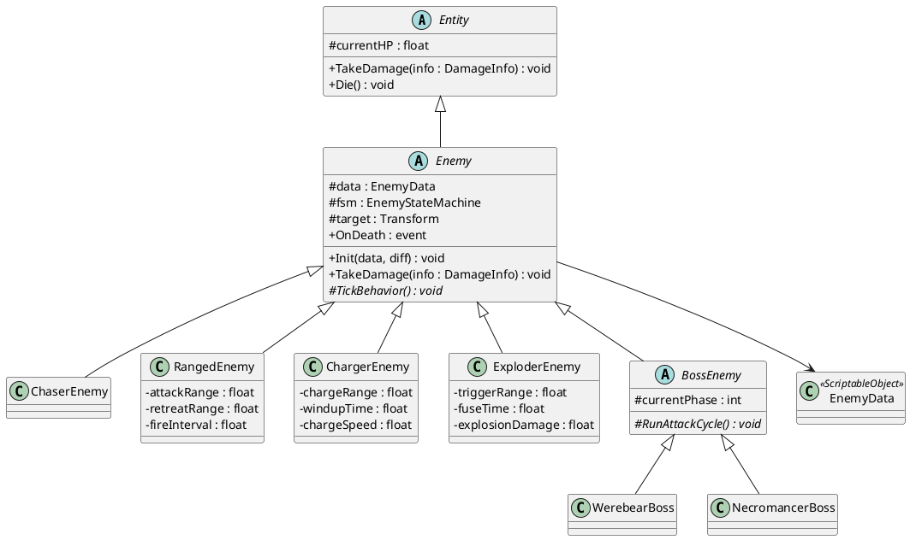
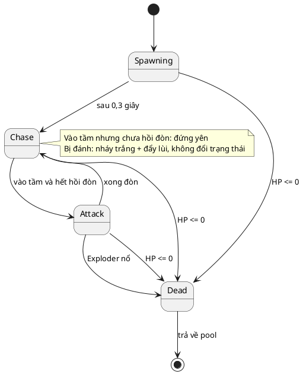

# Thiết kế quái (Enemy)

Game: Survival Action kiểu Vampire Survivors (Unity), 2,5D
Liên quan: `thiet-ke-nhan-vat.md` (loại sát thương), `kich-ban-man-choi.md` (kịch bản ván 30 phút)
Trạng thái: **Bản nháp v1**. Các con số là bản nháp cân bằng, chỉnh sau khi test.

Quy ước: tên class, hàm, biến trong code viết bằng tiếng Anh.

---

## 1. Chủ đề và nguồn sprite

**Chủ đề:** đội quân **Undead** (xương, Necromancer) liên minh với **bộ tộc Orc** và **thú hóa** (Werewolf, Werebear) tràn vào vương quốc. 4 anh hùng người (Kiếm sĩ, Cung thủ, Pháp sư, Đỡ đòn) đứng ra chống lại.

Toàn bộ sprite quái lấy từ **Tiny RPG Character Asset Pack (bản đầy đủ $2,50)**. Các nhân vật người trong gói (Soldier, Knight, Swordsman, Archer, Wizard, Priest, Lancer, …) **để dành cho phe người chơi**, không dùng làm quái, để người chơi không nhầm phe.

| Sprite trong gói | Dùng làm |
|---|---|
| Slime | Quái cơ bản giai đoạn 1, và biến thể Slime nổ (tô màu đỏ) |
| Bat | Quái nhanh, bay theo đàn |
| Skeleton | Quái cơ bản từ phút 3 |
| Armored Skeleton | Quái trâu từ phút 18 |
| Greatsword Skeleton | Elite giai đoạn 3 |
| Skeleton Archer | Quái bắn xa |
| Orc | Quái cơ bản nặng |
| Armored Orc | Quái trâu |
| Elite Orc | Elite giai đoạn 1–2 |
| Orc Rider | Quái lao thẳng (sự kiện Càn quét) |
| Werewolf | Quái nhanh và khỏe giai đoạn 3 |
| Werebear | **Mini-boss** phút 15 và 25 |
| Necromancer | **Boss cuối** phút 30 (có sẵn animation triệu hồi) |

---

## 2. Bộ chỉ số chung của quái (`EnemyData`)

| Chỉ số | Mã | Ý nghĩa |
|---|---|---|
| Máu tối đa | `maxHP` | Máu gốc, trước khi nhân hệ số độ khó |
| Tốc độ | `moveSpeed` | Đơn vị/giây (Player gốc là 5) |
| Khối lượng | `mass` | Khối lượng `Rigidbody2D`. Quái nặng đẩy được quái nhẹ trong đám đông |
| Sát thương đòn đánh | `attackDamage` | Sát thương mỗi đòn trúng Player |
| Nhịp đánh | `attackInterval` | Thời gian giữa hai lần bắt đầu đòn đánh (Slime: 1 giây) |
| Tầm đánh | `attackRange` | Khoảng cách **mép collider quái → mép collider Player** để bắt đầu đánh (quái cận chiến: 0,25, đủ để vòng quái thứ hai chen vào đánh) |
| Thời điểm trúng | `attackHitTime` | Số giây từ lúc bắt đầu đòn đến lúc gây sát thương. Lúc này kiểm tra lại tầm, Player đã ra khỏi tầm thì **đòn trượt** |
| Giáp | `armorPercent` | Giảm % sát thương **vật lý** nhận vào (0–0,8) |
| Kháng phép | `magicResistPercent` | Giảm % sát thương **phép** nhận vào (0–0,8) |
| Kháng đẩy lùi | `knockbackResist` | 0 = bị đẩy hết lực, 1 = miễn nhiễm |
| XP rơi ra | `xpDrop` | Giá trị gem XP |
| Vàng rơi ra | `coinDropChance`, `coinAmount` | Tỉ lệ và lượng vàng |
| Thời gian xác | `corpseDuration`, `corpseFadeDuration` | Xác nằm lại sau khi hết animation chết (mặc định 3 giây), mờ dần ở cuối (0,5 giây) |
| Hành vi | `behavior` | `Chaser` / `Ranged` / `Charger` / `Exploder` / `Boss` |
| Rơi rương | `dropsChest` | Elite và boss: `true` |

Chỉ số dành riêng cho từng hành vi (tầm bắn, thời gian nạp nổ, …) khai báo ở **lớp con** tương ứng, giống cách làm với Player.

### Công thức

```
HP thực tế      = maxHP × diff.hpMul          (không tăng theo thời gian)
Sát thương thực = attackDamage × diff.damageMul
Tốc độ thực     = moveSpeed × diff.speedMul
Sát thương nhận = dmg × (1 − armorPercent)         nếu Physical
                = dmg × (1 − magicResistPercent)   nếu Magic
Lực đẩy lùi     = weapon.knockback × (1 − knockbackResist)
```

### Độ khó tăng theo thời gian bằng **thành phần quái**, không bằng chỉ số

Trong cả ván, chỉ số của từng loại quái **cố định**. Áp lực tăng dần nhờ ba cơ chế:
1. **Quái mạnh hơn xuất hiện muộn hơn**, theo các mốc thời gian trong kịch bản.
2. **Trọng số spawn dịch dần** từ quái yếu sang quái mạnh. Bảng trọng số chi tiết ở `kich-ban-man-choi.md`.
3. **Số lượng và nhịp spawn** tăng theo `WaveData` (`maxAlive`, `spawnInterval`).

Quái yếu vẫn tiếp tục xuất hiện ở cuối ván để làm "mồi XP" cho người chơi lên cấp.

Chỉ còn hệ số theo **độ khó** (`diff.hpMul`), vì độ khó là tùy chọn của ván chứ không phải tiến trình.

### Quyết định: quái không có sát thương phép

Mọi sát thương quái gây ra đều bị **`Armor` của Player** giảm (trừ thẳng), kể cả phép của Necromancer. Player **không cần** thêm chỉ số kháng phép. Như vậy hệ thống sát thương phép chỉ tồn tại ở một chiều (Player → quái), giữ Player đơn giản. (Đóng câu hỏi ở mục 11 của `thiet-ke-nhan-vat.md`.)

### Nguyên tắc kháng

Để không lớp nhân vật nào bị thiệt hoàn toàn:
- Quái **giáp dày** (Armored Orc, Armored Skeleton) có Giáp cao, Kháng phép thấp → **Pháp sư và hào quang Guardian khắc chế**.
- Quái **undead** có Kháng phép nhẹ → sát thương vật lý hiệu quả hơn một chút.
- Không quái thường nào có kháng vượt 40%. Chỉ boss được tới 30% cả hai loại.

---

## 3. Danh sách quái

Giá trị gốc ở độ khó **Trung bình** (trước khi nhân hệ số độ khó).

### 3.1. Quái thường

| ID | Sprite | Vai trò | HP | Tốc độ | Va chạm | Giáp | Kháng phép | Kháng đẩy | XP | Vàng |
|---|---|---|---|---|---|---|---|---|---|---|
| `Slime` | Slime | Quân số giai đoạn 1 | 10 | 2,0 | 5 | 0% | 0% | 0 | 1 | 5% × 1 |
| `Bat` | Bat | Nhanh, bay theo đàn | 5 | 4,5 | 3 | 0% | 0% | 0 | 1 | 3% × 1 |
| `Skeleton` | Skeleton | Quân số từ phút 3 | 18 | 2,2 | 7 | 10% | 20% | 0,1 | 2 | 8% × 1 |
| `Orc` | Orc | Quân số nặng | 25 | 2,0 | 8 | 10% | 0% | 0,2 | 2 | 8% × 1 |
| `ArmoredOrc` | Armored Orc | Chặn đường | 60 | 1,5 | 12 | 40% | 0% | 0,6 | 5 | 15% × 2 |
| `ArmoredSkeleton` | Armored Skeleton | Chặn đường từ phút 18 | 50 | 1,6 | 10 | 35% | 20% | 0,5 | 5 | 15% × 2 |
| `SkeletonArcher` | Skeleton Archer | Bắn xa | 15 | 2,0 | 4 | 0% | 20% | 0 | 3 | 10% × 1 |
| `ExplodingSlime` | Slime (tô đỏ) | Tự nổ | 12 | 3,0 | — | 0% | 0% | 0 | 2 | 5% × 1 |
| `OrcRider` | Orc Rider | Lao thẳng | 35 | 2,0 (lao 9,0) | 15 | 20% | 0% | 0,8 | 4 | 12% × 2 |
| `Werewolf` | Werewolf | Nhanh và khỏe | 40 | 4,0 | 10 | 10% | 10% | 0,3 | 5 | 15% × 2 |

### 3.2. Elite (rơi rương)

| ID | Sprite | HP | Tốc độ | Va chạm | Giáp | Kháng phép | Kháng đẩy | Xuất hiện |
|---|---|---|---|---|---|---|---|---|
| `EliteOrc` | Elite Orc | 150 | 2,2 | 15 | 20% | 10% | 0,8 | Từ phút 8 |
| `GreatswordSkeleton` | Greatsword Skeleton | 200 | 2,0 | 18 | 25% | 25% | 0,8 | Từ phút 22 |

Elite hiển thị **to hơn 1,5 lần** và có viền sáng để người chơi nhận ra. Luôn rơi rương (chọn 1 nâng cấp miễn phí) và 10 vàng.

### 3.3. Hành vi riêng

| Hành vi | Quái | Mô tả | Chỉ số riêng (lớp con) |
|---|---|---|---|
| `Chaser` | Slime, Bat, Skeleton, Orc, Armored…, Werewolf, Elite | Đi thẳng tới Player | — |
| `Ranged` | SkeletonArcher | Đuổi đến khi còn cách Player 6 đơn vị thì đứng lại, bắn tên theo hướng Player mỗi 2,5 giây. Nếu Player áp sát dưới 3 đơn vị thì lùi lại. **Chỉ bắn khi đường bay thông thoáng:** trước mỗi phát, `CircleCast` từ quái tới Player trên layer `Obstacle` + `Enemy`; bị chặn thì không bắn mà tiếp tục di chuyển tìm góc bắn | `attackRange` 6, `retreatRange` 3, `fireInterval` 2,5, `projectileDamage` 8, `projectileSpeed` 7 |
| `Charger` | OrcRider | Đi chậm; khi cách Player 7 đơn vị thì dừng 0,6 giây (báo hiệu), rồi lao thẳng theo hướng đã khóa với tốc độ 9 trong 1 giây, không đổi hướng | `chargeRange` 7, `windupTime` 0,6, `chargeSpeed` 9, `chargeDuration` 1,0 |
| `Exploder` | ExplodingSlime | Đuổi nhanh; khi cách Player 1,2 đơn vị thì nhấp nháy 0,5 giây rồi nổ, gây 20 sát thương trong bán kính 1,5. Nếu bị giết trước thì **không nổ** | `triggerRange` 1,2, `fuseTime` 0,5, `explosionDamage` 20, `explosionRadius` 1,5 |

Trong sự kiện **Swarm**, Bat bay thẳng theo một hướng cố định băng qua màn hình rồi biến mất, không đuổi theo Player.

---

## 4. Boss

### 4.1. Mini-boss: Werebear (phút 15:00 và 25:00)

| HP | Tốc độ | Va chạm | Giáp | Kháng phép | Kháng đẩy | XP |
|---|---|---|---|---|---|---|
| 800 | 2,2 | 20 | 20% | 20% | 1 (miễn nhiễm) | 50 |

Chu kỳ tấn công (lặp lại):
1. **Đuổi** trong 4 giây.
2. **Đập đất:** đứng lại, vẽ vòng tròn cảnh báo bán kính 2,5 dưới chân trong 0,8 giây, rồi gây 25 sát thương cho Player nếu đứng trong vòng.
3. **Lao tới:** khóa hướng, lao 6 đơn vị với tốc độ 8.

Rơi: rương + 30 vàng. Ở độ khó Khó, phút 25:00 xuất hiện 2 con.

### 4.2. Boss cuối: Necromancer (phút 30:00)

| HP | Tốc độ | Va chạm | Giáp | Kháng phép | Kháng đẩy | XP |
|---|---|---|---|---|---|---|
| 3000 | 1,8 | 15 | 30% | 30% | 1 (miễn nhiễm) | — (thắng lượt chơi) |

Necromancer **giữ khoảng cách** 5–7 đơn vị với Player, giống quái bắn xa.

**Pha 1 (100% → 50% HP):**
- **Triệu hồi** (mỗi 8 giây): phát animation triệu hồi 1 giây, gọi 6 Skeleton quanh mình.
- **Loạt cầu tối** (mỗi 3 giây): bắn 5 quả cầu hình quạt 40° về phía Player, mỗi quả 12 sát thương.

**Pha 2 (dưới 50% HP):**
- **Dịch chuyển** (mỗi 10 giây): biến mất 0,5 giây, xuất hiện ở vị trí ngẫu nhiên cách Player 6 đơn vị.
- **Triệu hồi** đổi thành 4 Armored Skeleton.
- **Vòng cầu tối** (mỗi 5 giây): bắn 12 quả cầu tỏa đều 360°.
- Loạt cầu tối vẫn giữ.

**Pha 2 chỉ có ở độ khó Khó.** Ở Dễ và Trung bình, Necromancer giữ pha 1 đến khi chết.

Khi Necromancer chết: toàn bộ quái còn lại trên màn hình chết theo, chuyển sang màn Victory.

---

## 5. Trạng thái của quái (FSM)

| Trạng thái | Vào khi | Làm gì | Ra khi |
|---|---|---|---|
| `Spawning` | Vừa lấy ra từ pool | Hiện dần trong 0,3 giây, **không gây và không nhận sát thương** | Hết 0,3 giây → `Chase` |
| `Chase` | Mặc định | Đi về phía Player. Vào tầm nhưng chưa hồi đòn thì đứng yên | Vào `attackRange` và hết hồi đòn → `Attack` |
| `Attack` | `Chaser`: vào tầm đánh · `Ranged`: vào tầm bắn · `Charger`: vào tầm lao · `Exploder`: vào tầm nổ | Chaser: đứng yên, phát animation Attack, đến `attackHitTime` kiểm tra lại tầm rồi gây sát thương · các hành vi khác: bắn / báo hiệu rồi lao / nhấp nháy rồi nổ | Hết animation Attack → `Chase` (Exploder: → `Dead`) |
| `Dead` | HP về 0 | Phát Death, rơi XP và vàng, báo `OnDeath` cho SpawnManager. Tắt vật lý. Xác nằm lại `corpseDuration` (3 giây), mờ dần trong `corpseFadeDuration` (0,5 giây) cuối. Xác không bị dịch chuyển và không tính vào số quái sống | Hết animation + `corpseDuration` → trả về pool |

- **Không có sát thương va chạm.** Quái chỉ gây sát thương bằng đòn đánh trong trạng thái `Attack`, nhịp theo `attackInterval`.
- **Va chạm vật lý:** mỗi quái có `Rigidbody2D` Dynamic và collider ôm phần chân (mặc định `CapsuleCollider2D` nằm ngang), nên quái không chồng lên nhau và tự xếp vòng vây. Player là Kinematic nên bị vây là kẹt thật. Lúc `Dead` tắt `simulated` để xác không chắn đường.
- **Animator của quái** phải có các state tên đúng `Move`, `Attack`, `Die`. State `Idle` là tùy chọn: khi có, quái phát `Idle` lúc đứng trong tầm chờ hồi đòn; khi không có thì giữ `Move`. Code gọi `Animator.Play` theo tên, không dùng transition. Idle chỉ là animation, không phải trạng thái FSM.
- **Bị đánh không phải trạng thái.** Quái nháy trắng 0,1 giây và bị đẩy lùi theo `knockbackResist`, FSM giữ nguyên.
- **Boss** có FSM riêng theo chu kỳ tấn công ở mục 4.

---

## 6. Kiến trúc lớp

```
Entity (HP, TakeDamage, Die)
 └── Enemy (abstract): EnemyData, FSM, di chuyển, va chạm, kháng, đẩy lùi, rơi đồ, OnDeath
      ├── ChaserEnemy
      ├── RangedEnemy     (attackRange, retreatRange, fireInterval, …)
      ├── ChargerEnemy    (chargeRange, windupTime, chargeSpeed, …)
      ├── ExploderEnemy   (triggerRange, fuseTime, explosionDamage, …)
      └── BossEnemy (abstract): chu kỳ tấn công, pha
           ├── WerebearBoss
           └── NecromancerBoss
```

- Cùng một lớp hành vi dùng cho nhiều quái: Slime, Skeleton, Orc, … đều là `ChaserEnemy` với `EnemyData` khác nhau. Thêm quái mới chỉ cần tạo `EnemyData` và prefab mới, không viết code.
- Chỉ boss mới cần lớp riêng.

```csharp
public abstract class Enemy : Entity
{
    [SerializeField] protected EnemyData data;
    protected Transform target;                  // Player
    protected EnemyStateMachine fsm;             // Spawning, Chase, Attack, Dead
    private float attackCooldown;

    public event System.Action<Enemy> OnDeath;   // SpawnManager đếm quái sống, rơi XP

    public virtual void Init(EnemyData data, DifficultyData diff) { /* tính HP, dmg, speed thực */ }

    public override void TakeDamage(DamageInfo info)
    {
        float resist = info.type == DamageType.Physical ? data.armorPercent : data.magicResistPercent;
        currentHP -= info.amount * (1f - resist);
        // nháy trắng, đẩy lùi
        if (currentHP <= 0) Die();
    }

    // Chase: Collider2D.Distance(playerCollider) <= attackRange và hết hồi đòn → Attack
    // Attack: đứng yên, đến attackHitTime kiểm tra lại tầm → EnemyManager gọi player.TakeDamage

    protected abstract void TickBehavior();      // lớp con: Ranged, Charger, Exploder, Boss
}
```

---

## 7. Ghép vào kịch bản ván 30 phút

| Vai trò | Giai đoạn 1 (0–10') | Giai đoạn 2 (10–20') | Giai đoạn 3 (20–30') |
|---|---|---|---|
| Quân số | Slime, Skeleton, Orc | Skeleton, Orc (Slime giảm dần) | Skeleton, Orc |
| Nhanh | Bat | Bat | Bat, **Werewolf** |
| Trâu | Armored Orc | Armored Orc, **Armored Skeleton** | Armored Orc, Armored Skeleton |
| Bắn xa | — | **Skeleton Archer** | Skeleton Archer |
| Tự nổ | — | **Exploding Slime** | Exploding Slime |
| Lao thẳng (Line) | — | **Orc Rider** | Orc Rider |
| Elite | **Elite Orc** | Elite Orc | **Greatsword Skeleton** |
| Boss | — | **Werebear** (phút 15) | Werebear (phút 25), **Necromancer** (phút 30) |

In đậm = lần đầu xuất hiện.

Mỗi giai đoạn có quái mới xuất hiện, nên sau mỗi lần ra khỏi Shop người chơi đều gặp thứ mới. Mốc thời gian chi tiết ở `kich-ban-man-choi.md`.

---

## 8. Rơi đồ

| Vật phẩm | Khi nào | Ghi chú |
|---|---|---|
| Gem XP | Mọi quái, luôn luôn | 3 màu theo giá trị: xanh dương (1–2), xanh lá (3–9), đỏ (≥ 10). Gem to hơn khi giá trị cao |
| Coin | Theo `coinDropChance` | Hiển thị trên HUD, cuối ván cộng vào vàng tài khoản |
| Rương | Elite, mini-boss (`dropsChest`) | Nhặt → mở bảng chọn 1 trong 3 nâng cấp miễn phí (dùng lại bảng lên cấp) |
| Gộp gem | Khi có hơn 300 gem trên bản đồ | Gem mới gộp vào gem gần nhất để giữ hiệu năng |

---

## 9. Asset

- **Quái:** [Tiny RPG Character Asset Pack – Zerie](https://zerie.itch.io/tiny-rpg-character-asset-pack), **bản đầy đủ 22 nhân vật đã mua và import** tại `Assets/UI/RPG/Tiny RPG Character Asset Pack 01 v2.0 -Full 22 Characters/Characters(100x100 split)/`. Đề xuất chuyển sang `Assets/Art/Characters/` cho đúng cấu trúc thư mục (sprite nhân vật không phải UI); chuyển **bên trong Unity** để giữ file `.meta`.
- **Phân bổ 22 nhân vật:**
  - Phe người chơi (4): Swordsman, Archer, Wizard, Knight Templar (Guardian).
  - Quái (13): Slime, Bat, Skeleton, Armored Skeleton, Greatsword Skeleton, Skeleton Archer, Orc, Armored Orc, Elite Orc, Orc rider, Werewolf, Werebear, Necromancer.
  - Chưa dùng (5): Knight, Soldier, Lancer, Armored Axeman, Priest. Để dành cho nhân vật mở rộng, NPC ở Shop, hoặc skin thay thế.
- **Exploding Slime:** dùng sprite Slime, tô đỏ bằng `SpriteRenderer.color`; vụ nổ lấy từ [200 Pixel Shader Explos and Power – BDragon1727](https://bdragon1727.itch.io/200-pixel-shader-explos-and-power).
- **Đạn Skeleton Archer:** sprite tên có sẵn trong Tiny RPG.
- **Cầu tối của Necromancer:** [500 Pixel Bullet 24x24 – BDragon1727](https://bdragon1727.itch.io/500-pixel-bullet-24x24) (chọn màu tím).
- **Vòng cảnh báo đập đất của Werebear:** vẽ vòng tròn đỏ bán trong suốt bằng sprite đơn giản, hoặc lấy từ [Magic Shader All – BDragon1727](https://bdragon1727.itch.io/magic-shader-all).

---

## 10. Còn cần chốt

- Thời gian sống của đạn quái và việc đạn quái có bị vũ khí của Player phá không (đề xuất: không).
- Có dùng Priest làm quái hỗ trợ (hồi máu cho quái xung quanh) không? Đề xuất: **không**, để Priest cho phe người và giữ phạm vi dự án.

---

## Phụ lục: PlantUML

### Class Diagram



### State Diagram (quái thường)


